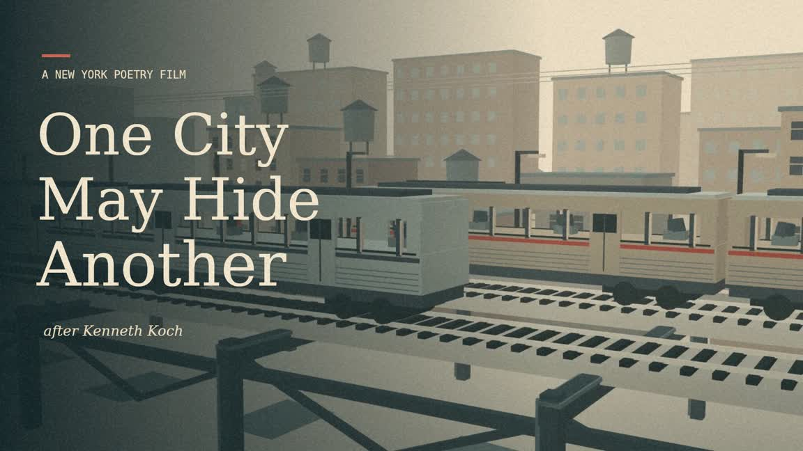
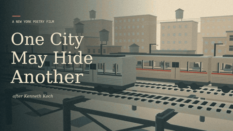

# One City May Hide Another

[Watch the film and explore the railway](https://one-city-may-hide-another.flutedjoust3.chatgpt.site) · [Download the 1080p screening edition](https://github.com/qrran/one-city-may-hide-another/releases/tag/v1.0.0)



A 2 minute 52 second computational poetry film about a New York student on the way to class. A coffee vendor taps a cup twice. Somebody holds a brass door. The morning goes by a second time, and those gestures have time to register.

Dan Lin developed the direction through conversation with ChatGPT. The drawings, modeled railway, score, original English text and synthesized voice were made for this film. The commute and its characters are imagined.

## Watch the movement



The camera returns to the same elevated line three times. Move the pointer in the interactive railway set to find sightlines between two trains. The left and right arrow keys work when the canvas has keyboard focus. The slider moves both trains through the same 22-second sequence.

## Run

Use Node 22 or later, npm, and FFmpeg with H.264 and AAC support on your path. The project ships the voice takes, stereo mixes, fonts and rendered railway shot. The interactive WebGL scene uses the local Three.js installation.

```sh
npm ci
npm run rail          # interactive model at http://127.0.0.1:4173
npm run studio        # review the complete timeline in Remotion Studio
npm run render        # out/One-City-May-Hide-Another.mp4
```

`npm run bundle:rail` makes a self-contained HTML edition at `dist/NYC-Rail-Study.html`. Open it in a browser with WebGL 2. It also works offline.

## How the film is made

- [The three-dimensional set](src/rail-world.js) contains modeled rolling stock, window frames, track beds, steelwork, buildings and rooftop tanks. Both the interactive edition and the offline rail bake use the same scene graph and camera motion.
- [The print plates](scripts/plates.mjs) generate the street, station window, campus threshold, hands, mugs and figures from SVG paths. The two visits to Broadway reuse the same background and the same spoon movement.
- [The editorial timeline](src/score.json) holds all shot boundaries and original spoken lines. [The frame painter](src/paint.ts) composites each exposure. It runs in the [Remotion composition](src/index.tsx) and in the [headless export](scripts/render.mjs).
- [The sound score](scripts/sound.py) synthesizes the moving trains, traffic, wheel joints, spoon taps, hinge and three-note musical figure. The two cart sequences use the same pitches, spacing and tap gain. The van moves and the traffic mix recedes on the reprise.

The screening master is a 1920 × 1080, 24 fps H.264 MP4. The illustrations are held for two frames per exposure. English narration and original sound are the default stereo track. The second track contains the soundscape alone. Spoken subtitles are printed into the image. An optional English CC track identifies sound events.

## Change a shot or a voice

After an artwork edit, `npm run studio` and `npm run render` rebuild the plates. For a quick proof image use `npm run art` followed by `node scripts/render.mjs --stills 3,34,108`. To change the physical railway set, use `npm run bake:rail` with Chrome installed and FFmpeg available. Set `CHROME_BIN` if Chrome lives elsewhere. On Linux with Mesa EGL, `python3 -m pip install moderngl numpy` and `python3 scripts/rail_gl.py` provide an alternative bake using the same geometry.

To record a different reading, replace the numbered mono PCM WAV files in `public/voice/` in the order in `src/score.json`. Install NumPy and SciPy, then run `npm run sound` and `npm run render`. To regenerate the supplied Kokoro performance, install `kokoro-onnx==0.6.1`, obtain the npm archives `kokoro-q8-shards@1.0.0` and `kokoro-local-runtime@0.1.0` with `npm pack`, and pass their paths to `python3 scripts/voice.py MODEL_ARCHIVE VOICES_ARCHIVE`.

## Reading and credits

Kenneth Koch's poem starts with a line of poetry before it gives the example of the two trains. A line break divides the phrase “at least.” Reading across that small delay suggested a film that brings back an image a viewer may already feel finished with. The second visit makes one action legible while leaving the stranger's story open. [Read “One Train May Hide Another” at the Academy of American Poets.](https://poets.org/poem/one-train-may-hide-another)

Three.js supplies the scene graph and interactive WebGL renderer. The screening master uses the Three.js camera and mesh data, a headless projection, the shared TypeScript compositor and FFmpeg. The English narration uses the Kokoro v1 `af_heart` preset. The bundled DejaVu typefaces include their [license and notices](public/fonts/LICENSE.txt). The New York scenes are original composites. [Three.js](https://threejs.org/) · [Remotion](https://www.remotion.dev/) · [Kokoro](https://huggingface.co/hexgrad/Kokoro-82M)
